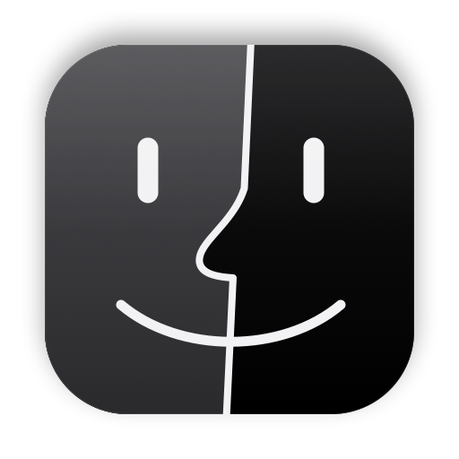
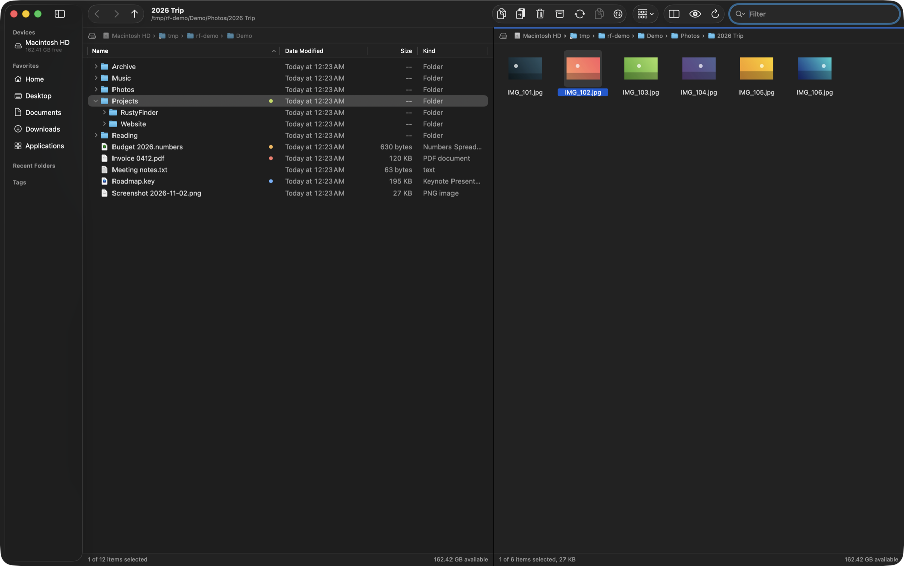
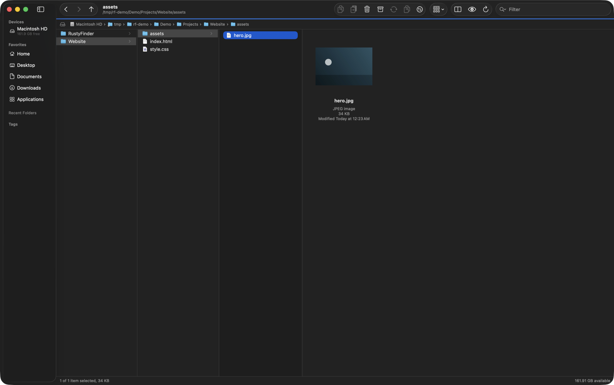
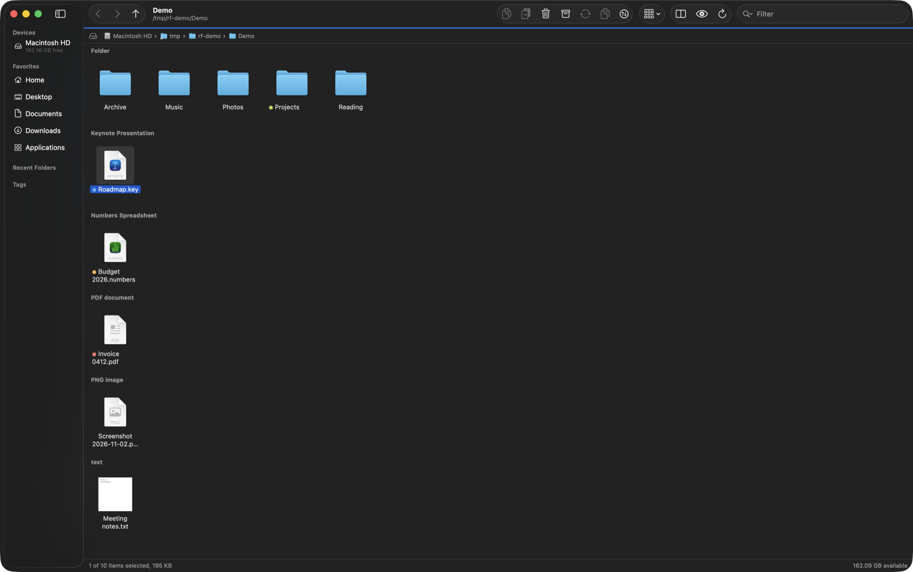

<p align="center">
  
</p>

<h1 align="center">RustyFinder</h1>

<p align="center">A fast, native, local-first file manager for macOS, powered by Rust.</p>

<p align="center">
  
</p>

RustyFinder is a dual-pane file manager for people who live in their files
all day. The interface is plain AppKit, so it behaves like a Mac app: real
menus, Quick Look, drag and drop, keyboard everywhere, light and dark. All
file-system work happens in a Rust core, so a folder with 100,000 items
lists and sorts in a fraction of a second.

It is local-first: no account, no subscription, no telemetry, no network
traffic unless you open a server yourself.

## Why it exists

Finder is good at looking at files and slow at working with them. RustyFinder
keeps what Finder does well (Quick Look, tags, native look) and adds what
heavy daily use needs: two panes, tabs, a transfer queue you can pause,
conflict handling that never overwrites silently, servers in the same
window, batch rename, folder sync, and every command on the keyboard.

## Features

**Browsing.** Two panes (side by side, stacked or one) with tabs you can
pin, drag and reorder. List, Icon and Column views. Sort by any column,
group by kind, dates, size or tags, expand folders in place, spring-loaded
folders while dragging. View settings are kept per folder (View Options,
⌘J). A sidebar with devices, shares, favorites, workspaces, recent folders
and tags; a path bar; back, forward, enclosing folder; session restore.

<p align="center">
  
</p>

**File operations.** Copy and move between panes, copy and paste, drag and
drop, duplicate, rename in place, new folder or file, aliases and symlinks,
Move to Trash, Delete Immediately (asks first). Everything runs in a
transfer queue with pause, stop, progress, automatic retries and optional
speed limits; interrupted copies resume. Name conflicts ask (Replace,
Replace Older, Keep Both, Skip, Merge, Stop, with "apply to all") or follow
a policy, and replacing a folder that would lose items always asks. Undo and
redo per window, an operation log, and "Retry as Administrator" through the
system's own password prompt.

**Looking at things.** Quick Look (also for files on servers and inside
archives), a preview pane with editable text, Info with permissions, ACLs,
tags and comments, Get Info windows, folder sizes on request, thumbnails in
every view.

<p align="center">
  
</p>

**Finding things.** Quick Open for commands, favorites and folders; Go to
Folder with completion; Quick Select by pattern or tag; filter as you type;
search by name, extension, kind, tag or content with RustyFinder's engine
(works on servers and in archives) or Spotlight; saved searches.

**Batch work.** Multi-Rename with stacked rules (dates, metadata, counters,
regular expressions) and a live preview; folder Sync with a plan you review
first; Compare in FileMerge, Kaleidoscope, Beyond Compare or Araxis; your own
command-line tools with safely quoted placeholders, in menus or the toolbar;
checksums; Open in Terminal; git status and common git commands.

**Archives.** Browse zip, tar (gz, bz2, xz, zst), 7z, rar and more as
folders, including password-protected ones; Extract, Compress (zip or 7z
with a password, tar.gz, tar.bz2, tar.xz).

**Servers.** SFTP through the system `ssh` (your `~/.ssh/config`, keys and
agent work), FTP and FTP with TLS, WebDAV and WebDAV over HTTPS, Amazon S3
and S3-compatible services, and SMB / AFP / NFS shares mounted by macOS.
Passwords go to the keychain; certificates you trust are pinned.

**App Deleter.** Moving an app to the Trash can show the files it left in
your Library (support files, preferences, caches, containers, logs, saved
state), matched by bundle ID. Uncertain matches start unticked, and
everything goes to the Trash as one undoable step.

**Making it yours.** Settings for behavior, transfers, editors, tags, tools
and every keyboard shortcut; themes with an editor; a favorites manager;
workspaces that save a whole window under a name.

## Install

RustyFinder needs **macOS 26** on Apple silicon.

Build it and put it in `/Applications`:

```bash
git clone https://github.com/daniel3606/rustyfinder.git
```

```bash
cd rustyfinder && scripts/install.sh
```

`scripts/install.sh --user` installs into `~/Applications` instead. The app
is ad-hoc signed, not notarized by Apple: it runs as an app you built
yourself. A zip from the Releases page has to be allowed once in System
Settings › Privacy & Security.

To update, pull and run `scripts/install.sh` again. To remove it, run
`scripts/uninstall.sh` (add `--purge` to also move its settings to the
Trash).

## Build from source

You need Xcode, a Rust toolchain (`cargo`) and XcodeGen
(`brew install xcodegen`).

```bash
scripts/build.sh
```

```bash
open build/RustyFinder.app
```

The script builds the Rust core as a static library, wraps it in an
XCFramework, generates the Swift bindings with UniFFI, generates the Xcode
project and builds `build/RustyFinder.app`. `--debug` builds the Swift side
in Debug; `--check` runs clippy and the Rust tests first.
`scripts/release.sh` packs a zip for a release.

## Tests

```bash
cargo fmt --all --check
```

```bash
cargo clippy --workspace --all-targets -- -D warnings
```

```bash
cargo test --workspace -- --test-threads=4
```

```bash
scripts/ui-smoke.sh
```

`ui-smoke.sh` launches the built app many times with scripted key presses
and checks what it shows. It needs no Accessibility permission, uses its own
settings folder and a scratch Trash, and never touches your files.
`scripts/ui-smoke.sh "columns:"` runs only the checks whose name contains
`columns:`. Servers are tested against small scripted servers in
`crates/rustyfinder-remote/tests/support/` and a throwaway local `sshd`.

```bash
cargo run --release -p rustyfinder-core --example bench
```

times listing, sorting and grouping a 100,000-file folder.

## Keyboard

The main defaults; every menu command can be rebound in Settings ›
Shortcuts.

| Key | Does |
|---|---|
| Tab | Switch pane |
| Return | Rename (several items: Multi-Rename) |
| ⌘↓ / ⌘↑ | Open / enclosing folder |
| ⌘[ / ⌘] | Back / forward |
| ⌘1 / ⌘2 / ⌘3 | Icons / List / Columns |
| ⌘→ / ⌘← | Expand / collapse folders in List view |
| ⌘J | View Options |
| F5 / F6 | Copy to / move to the other pane |
| ⌘⌫ / ⌥⌘⌫ | Move to Trash / Delete Immediately |
| Space / ⌘Y | Quick Look |
| Esc (in the file list) | Quick Open |
| ⇧⌘G | Go to Folder |
| ⌘F | Search or filter |
| ⌘S | Quick Select |
| ⌘K | Connect to Server |
| ⌘T / ⌘W | New tab / close tab |
| ⇧⌘. | Show hidden files |
| ⇧⌘P | Preview pane |
| ⇧⌘S | Calculate folder size |
| ⌥⌘F | Favorites manager |
| ⌥⌘⇧S | Sync to… |
| ⇧⌘X / ⇧⌘M | Extract / Compress |
| ⇧⌘R | Open in Terminal |

## How it is built

```
crates/rustyfinder-core     all logic, no UI: the Vfs trait, the local disk, the copy
                            engine, transfer queue, undo, conflicts, sync, rename
                            rules, search, archives, App Deleter, settings and
                            favorites storage
crates/rustyfinder-remote   SFTP, FTP, WebDAV and S3 behind the Vfs trait
crates/rustyfinder-ffi      the UniFFI surface the app talks to
crates/uniffi-bindgen       generates the Swift bindings
RustyFinderApp/             the AppKit app (XcodeGen project)
vendor/russh-sftp           patched SFTP client (lossless non-UTF-8 names)
scripts/                    build, install, release, UI checks, icon
docs/spec/                  the functional specs the app is built from
docs/GAPS.md                what the specs ask for and its status
docs/DECISIONS.md           design decisions and their reasons
```

A few rules hold everywhere:

- Every file system (disk, server, archive) implements one blocking `Vfs`
  trait, so copying, search and sync work on all of them.
- The UI never holds a folder's contents. It keeps a handle to an immutable,
  sorted snapshot in Rust and asks for rows by index. Costly facts (date
  added, tags, Spotlight metadata) are read only when a view needs them.
- Rust calls back into Swift on background threads; Swift hops to the main
  thread. No file-system work happens on the main thread.
- Destructive operations go through the Trash or a confirmation. File names
  are treated as hostile: never normalised on disk, and anything that
  reaches a shell is quoted as one argument.

## Privacy

RustyFinder makes no network requests of its own. It talks to a server
only when you open one. Settings, favorites and the saved session live in
`~/Library/Application Support/RustyFinder/`; server passwords live in your
login keychain under "RustyFinder".

## Known limitations

- Apple silicon and macOS 26 only, as built here.
- Not notarized: it is ad-hoc signed.
- Tested against local scripted servers; SMB/NFS mounting, Bonjour
  discovery and keyboard-interactive SSH need real servers to verify. The
  full list, with reasons, is at the end of [docs/GAPS.md](docs/GAPS.md).
- Cloud drives are browsed as the folders their own apps keep; RustyFinder
  does not sign in to cloud services.

## Roadmap

- A universal (Intel and Apple silicon) build.
- More of the UI checked on real hardware (drags, hover states).
- Performance work on very large remote folders.

## License

[MIT](LICENSE). Third-party crates keep their own licenses (MIT, Apache-2.0,
MPL-2.0 for UniFFI, and others listed by `cargo metadata`); `vendor/russh-sftp`
is Apache-2.0 with the changes listed in its `VENDORED.md`.
